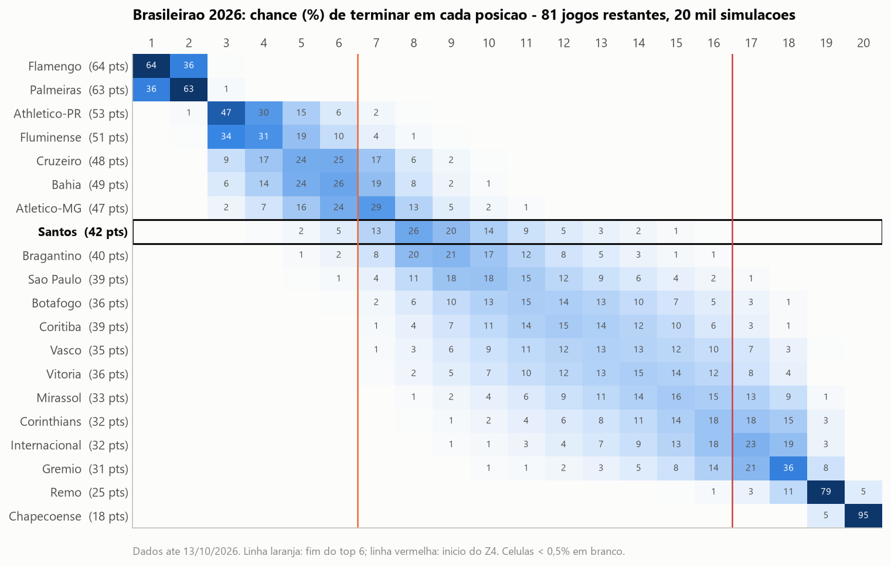
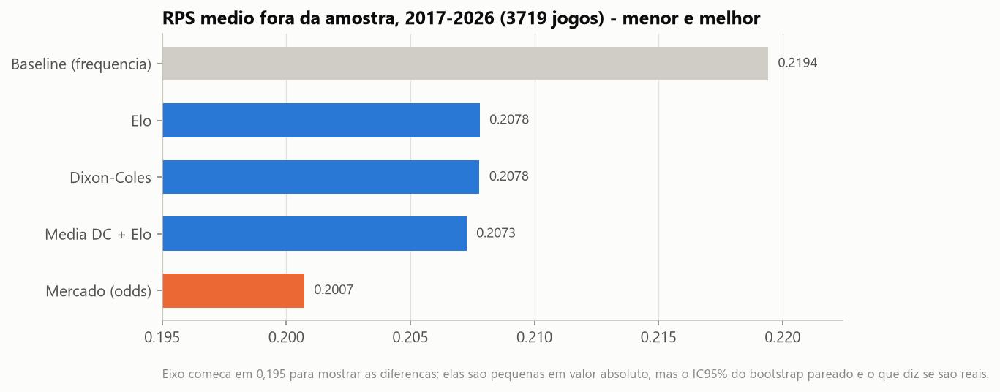
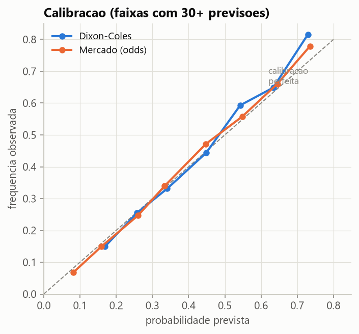
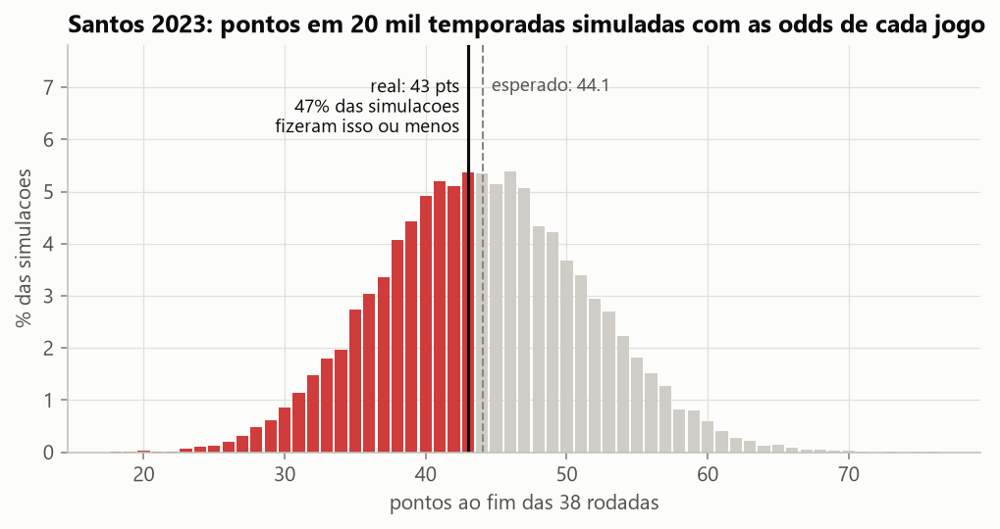
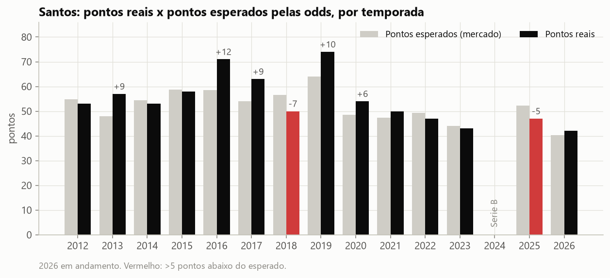
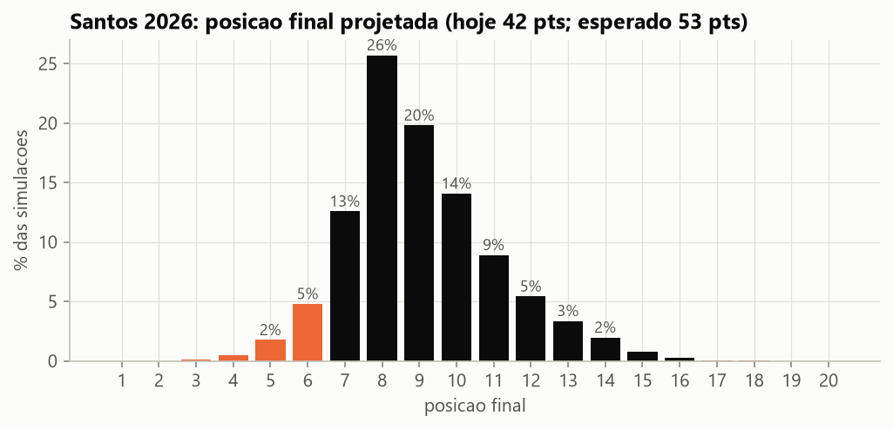
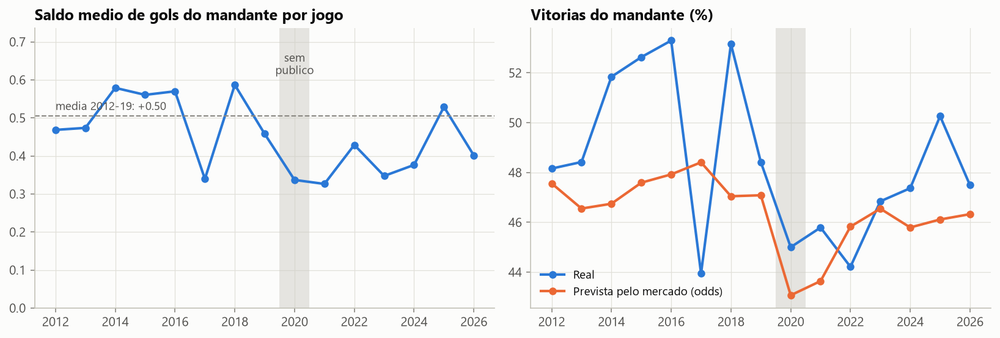

# Brasileirao em Numeros

[](https://github.com/Joaogmos/brasileirao-em-numeros/actions/workflows/ci.yml)

Modelo probabilistico do Campeonato Brasileiro Serie A (Dixon-Coles + Elo), treinado
com 5.618 jogos de 2012 a 2026, avaliado **fora da amostra contra as odds do mercado de
apostas**, e usado para responder perguntas reais sobre o Santos FC.

Projeto de portfolio de ciencia de dados. O foco nao e "acertar o campeao": e fazer
a validacao do jeito certo, medir incerteza e conseguir defender cada numero.



---

## 1. O problema

"O Santos vai cair?", "o mando de campo ainda vale alguma coisa?", "foi azar?" sao
perguntas que todo torcedor responde no achismo. Para responder com dados e preciso:

- um modelo que de **probabilidades** (nao palpites) para cada jogo;
- uma prova de que essas probabilidades sao boas **em jogos que o modelo nunca viu**;
- uma referencia dura para comparar — o mercado de apostas, que agrega informacao de
  muita gente com dinheiro em jogo;
- e um jeito de transformar probabilidade de jogo em probabilidade de tabela.

## 2. A solucao

| Etapa | O que faz | Onde |
|---|---|---|
| Dados | Snapshot versionado com SHA-256, limpeza e 9 regras de validacao da Serie A | `dados.py`, [ADR-1](docs/adr/adr-1-snapshot-versionado.md) |
| Modelos | Baseline de frequencia, Elo + logit ordinal, **Dixon-Coles** com peso temporal e ridge | `modelos/`, [ADR-3](docs/adr/adr-3-dixon-coles-com-ridge.md) |
| Validacao | **Walk-forward semanal**: o modelo so ve o passado; tuning so em 2014-16, teste em 2017-26 | `backtest.py`, [ADR-5](docs/adr/adr-5-validacao-walk-forward.md) |
| Metricas | **RPS**, log loss, Brier, calibracao e bootstrap pareado para cada comparacao | `metricas.py`, [ADR-7](docs/adr/adr-7-rps-como-metrica.md) |
| Simulacao | Monte Carlo do resto da temporada sorteando **placares** (desempates da CBF) | `simulacao.py`, [ADR-6](docs/adr/adr-6-monte-carlo-por-placar.md) |
| Produto | Notebook narrativo + painel Streamlit com simulador de confrontos | `notebooks/`, `app/` |

O coracao e o Dixon-Coles: gols de cada lado ~ Poisson, com ataque e defesa por clube,
vantagem de mando, correcao para placares baixos e jogos recentes pesando mais. Ajustado
por maxima verossimilhanca com gradiente analitico (~15 ms por ajuste):

```python
lam = exp(mu0 + mando + ataque[casa] + defesa[fora])   # gols esperados do mandante
mu  = exp(mu0 +         ataque[fora] + defesa[casa])   # gols esperados do visitante
nll = -sum(peso * log_verossimilhanca) + reg * (|ataque|^2 + |defesa|^2)
```

## 3. Os resultados

### Pergunta 1 — Da para prever melhor que o mercado? **Nao. E isso e o resultado.**

3.719 jogos de teste (2017-2026), previstos semana a semana so com o passado:

| Modelo | RPS | Log loss | Acuracia |
|---|---|---|---|
| Baseline (frequencia historica) | 0,2194 | 1,058 | 47,2% |
| Elo + logit ordinal | 0,2078 | 1,023 | 49,3% |
| Dixon-Coles | 0,2078 | 1,024 | 49,2% |
| Media Dixon-Coles + Elo | 0,2073 | 1,022 | 49,3% |
| **Mercado (odds de fechamento)** | **0,2007** | **1,001** | **51,1%** |

- Dixon-Coles bate o baseline com folga: RPS -0,0116, **IC95% [-0,0140; -0,0093]**.
- Dixon-Coles x Elo: **empate tecnico** (IC95% [-0,0011; +0,0011]).
- O mercado vence o modelo nas 10 temporadas: diferenca +0,0071, IC95% [+0,0051; +0,0089].
  Usando **so placares**, o modelo captura **62% do ganho** que o mercado tem sobre o baseline;
  o resto e informacao que placar nao carrega (escalacao, lesao, calendario).
- As probabilidades sao **calibradas**: quando o modelo diz 40%, acontece ~40% das vezes.

<p>


</p>

### Pergunta 2 — O rebaixamento do Santos em 2023 foi azar? **Nao. Foi queda de nivel.**

Pontos esperados (xPts) somam, jogo a jogo, `3 x P(vitoria) + P(empate)` tirados das odds
de fechamento.

- O Santos fez **43 pontos**; as odds esperavam **44,1**. Em 20 mil temporadas simuladas com
  essas probabilidades, **47%** terminam com 43 ou menos — resultado tipico, nao azarado.
- Foi favorito em **2 dos 38 jogos**. Sofreu 64 gols e 7 derrotas por 3+ gols.
- O que mudou foi o nivel ao longo do ano: **antes da 1a rodada** o Dixon-Coles via um time
  de meio de tabela (11o em forca, 50 pts esperados, 17% de risco de queda). O mercado foi
  percebendo a piora rodada a rodada, e o final ficou onde a piora apontava.

<p>


</p>

### Pergunta 3 — Onde o Santos termina 2026?

Com dados ate 13/10/2026 (8o, 42 pts em 30 jogos), 81 jogos restantes e 20 mil simulacoes:
**53 pontos esperados** (IC90%: 47 a 59), **8o ou 9o lugar mais provaveis**, **7% de chance
de top 6** e **0,1% de risco de rebaixamento**.

**Da para confiar?** A mesma projecao foi refeita "com 300 jogos disputados" em cada
temporada de 2017 a 2025: clubes na zona de duvida (10-90% de risco de queda) recebiam
**46%** em media e **45%** cairam. Os 16 com risco >= 90% cairam todos.



### Pergunta 4 — Quanto vale o mando? O que 2020 sem publico mostrou?

- 2012-2019, com publico: mandante faz **+0,50 gol/jogo** de saldo. 2020, portoes fechados:
  **+0,34 (-33%)**, IC95% da diferenca [-0,33; -0,01], p = 0,02 (teste de permutacao).
- **Ressalva honesta:** 2017, com torcida, caiu exatamente o mesmo. A variacao natural entre
  temporadas e grande e 2020 e uma amostra so — *evidencia consistente com o efeito da
  torcida, nao prova*.
- O mercado percebeu na hora: P(vitoria do mandante) media caiu de ~47% para 43% em 2020.



### Testes

35 testes (`pytest`), incluindo os que provam as propriedades que importam:

| Teste | Prova que... |
|---|---|
| `test_walk_forward_nunca_treina_com_o_futuro...` | um modelo-espiao nunca ve jogo do mesmo dia ou posterior |
| `test_dixon_coles_recupera_parametros_verdadeiros` | em liga sintetica, o ajuste recupera as forcas reais (r > 0,9) |
| `test_gradiente_analitico_bate_com_o_numerico` | a derivada escrita a mao esta certa |
| `test_rps_respeita_a_ordem_e_logloss_nao` | por que o RPS e a metrica certa para H > D > A |
| `test_snapshot_real_bate_com_manifesto_e_e_valido` | os dados sao exatamente os do manifesto e passam nas regras |
| `test_classificacao_aplica_desempates_da_cbf` | pontos > vitorias > saldo > gols pro |

## 4. Alternativas consideradas

| Abordagem | Por que nao |
|---|---|
| **k-fold aleatorio** | Vaza o futuro (treina com a rodada 30 para prever a 10). Numero otimista e falso. |
| **Acuracia como metrica** | Ignora a confianca: "34/33/33" e "90/5/5" contam igual. RPS e uma regra propria e respeita a ordem. |
| **Comparar so com o baseline** | Facil demais. O mercado e a referencia que diz se o modelo sabe algo. |
| **Gradient boosting (XGBoost) com features** | Preve H/D/A, mas nao gera distribuicao de placar coerente para simular desempates. |
| **Bayesiano hierarquico (PyMC)** | O "jeito certo" do ridge, com incerteza dos parametros. Mais lento e pesado de explicar — evolucao planejada. |
| **Sortear so H/D/A na simulacao** | Saldo e gols pro desempatam a tabela; sem placar viram sorteio. |

## 5. Como rodar

Requisitos: Python 3.11+.

```bash
python -m venv .venv && . .venv/Scripts/activate     # Linux/macOS: source .venv/bin/activate
pip install -e ".[dev,app]"

pytest                                    # 35 testes
python -m brasileirao.pipeline            # regenera tudo em reports/ (~3 min, com tuning)
python -m brasileirao.pipeline --rapido   # reusa os hiperparametros (~25 s)
streamlit run app/streamlit_app.py        # painel em http://localhost:8501

python -m brasileirao.dados --atualizar   # baixa a rodada mais recente da fonte
```

Cada analise tambem roda sozinha: `python -m brasileirao.backtest`,
`python -m brasileirao.analises.santos`, `...analises.projecao`, `...analises.mando`.

## 6. Arquitetura

```
data/raw/BRA.csv + MANIFEST.json      snapshot versionado (SHA-256 conferido)
        │
        ▼  dados.py         limpar() → validar()  (9 regras; jogo nao realizado → pendentes)
partidas (DataFrame)
        │
        ├─► modelos/        Frequencia · Elo + LogitOrdinal · DixonColes   (contrato: ajustar/prever)
        │       │
        │       ▼  backtest.py   walk-forward semanal → previsoes_teste.csv, metricas.json
        │
        ├─► simulacao.py    Monte Carlo por placar + tabela.py (desempates da CBF)
        │
        └─► analises/       mando.py · santos.py · projecao.py · avaliacao.py → reports/*.json, figures/
                                │
                                ▼
              notebooks/analise.ipynb  ·  app/streamlit_app.py
```

Stack: Python 3.13 · pandas · NumPy · SciPy (MLE, L-BFGS-B) · scikit-learn · matplotlib ·
Streamlit · pytest · ruff · GitHub Actions.

Dados: [football-data.co.uk](https://www.football-data.co.uk/brazil.php) — resultados e odds
da Serie A desde 2012. Detalhes e particularidades (o jogo nao realizado da Chapecoense em
2016) em [`data/README.md`](data/README.md).

## 7. Limitacoes e melhorias planejadas

- **So placares e odds.** Sem escalacao, lesoes, xG ou desgaste de calendario — e por isso o
  mercado vence. A proxima feature seria xG por jogo (FBref/Understat), que mede a qualidade
  das chances e e menos ruidoso que o gol.
- **Incerteza de parametros fora da simulacao.** Cada simulacao usa o mesmo ajuste do modelo,
  deixando as pontas um pouco confiantes demais. Correcao: bootstrap dos parametros ou um
  modelo bayesiano hierarquico (PyMC), que tambem trataria clube promovido de forma
  principiada em vez da heuristica do [ADR-4](docs/adr/adr-4-clube-promovido.md).
- **Mando por clube.** Hoje o mando e o mesmo para todos; altitude e viagens longas sugerem
  que nao e (ex.: jogar em Belem x em Sao Paulo).
- **Atualizacao automatica.** Um job semanal (GitHub Actions agendado) que baixa a rodada,
  roda o pipeline e publica o painel.

## 8. Uso de IA

Construido com o Claude Code como par de programacao. Sendo transparente:

**Meu (perguntas, decisoes e revisao):**
- As quatro perguntas, o recorte no Santos e a escolha de comparar com o mercado.
- As decisoes dos ADRs: snapshot com hash, walk-forward com divisao fixa, RPS como metrica,
  ridge no Dixon-Coles, simular placar e nao resultado.
- A leitura critica dos resultados (ex.: nao vender 2020 como prova causal; reportar que o
  modelo perde do mercado).

**Gerado com IA (a partir dessas decisoes):**
- Boa parte da implementacao, dos testes e das figuras, e a redacao inicial dos ADRs e deste
  README.

O criterio: so considero pronto o que **consigo explicar em voz alta sem olhar**.
